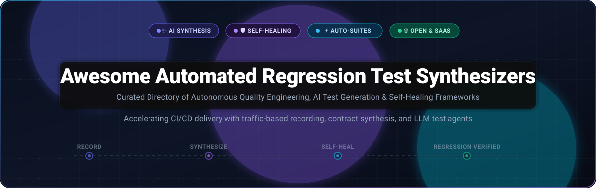

# 🚀 Awesome Automated Regression Test Synthesizers

<p align="center">
  
</p>

<p align="center">
  <a href="https://github.com/ishandutta2007/Awesome-Awesome-Awesome"></a><a href="https://discord.gg/jc4ttF58Ve"></a>
  <a href="https://github.com/ishandutta2007/Awesome-Automated-Regression-Test-Synthesizers/stargazers"></a>
  <a href="https://github.com/ishandutta2007/Awesome-Automated-Regression-Test-Synthesizers/network/members"></a>
  <a href="https://github.com/ishandutta2007/Awesome-Automated-Regression-Test-Synthesizers/blob/main/LICENSE"></a>
  <a href="https://github.com/ishandutta2007/Awesome-Automated-Regression-Test-Synthesizers/pulls"></a>
  <a href="https://github.com/ishandutta2007"></a>
</p>

---

> **A definitive, community-curated directory of AI-driven test generators, self-healing locator engines, traffic-to-suite synthesizers, and autonomous quality engineering tools.**

Automated Regression Test Synthesizers observe user behavior, network traffic, DOM interactions, and source code diffs to automatically author, maintain, and self-heal resilient regression suites. By replacing tedious manual test scripting with autonomous synthesis, teams accelerate CI/CD velocity and eliminate broken test maintenance.

---

## 📑 Table of Contents

- [📊 Sector Overview & Market Dynamics](#-sector-overview--market-dynamics)
- [🏢 SaaS & Hosted Platforms](#-saas--hosted-platforms)
- [🌐 Open-Source GitHub Projects](#-open-source-github-projects)
  - [Top Open-Source Frameworks (Sorted by Stars)](#top-open-source-frameworks-sorted-by-stars)
  - [Architectural Taxonomy](#architectural-taxonomy)
- [💡 Why Automated Regression Test Synthesis?](#-why-automated-regression-test-synthesis)
- [🛡️ Quality Evaluation & Mutation Testing](#️-quality-evaluation--mutation-testing)
- [🤝 How to Contribute](#-how-to-contribute)
- [💖 Support & Sponsorship](#-support--sponsorship)
- [📈 Star History](#-star-history)
- [⚠️ Disclaimer](#️-disclaimer)

---

## 📊 Sector Overview & Market Dynamics

* **Estimated Market Size & Growth:** The global software test automation sector is valued between **$24.2 billion and $32.7 billion in 2025–2026**, on track to surge past **$78 billion to $94 billion by 2030** at a compound annual growth rate (CAGR) of **14% to 16.9%**, powered heavily by generative AI agents and autonomous test synthesis technologies.
* **Market Concentration vs. Fragmentation:** The landscape exhibits a **bifurcated hybrid structure**—it is **moderately concentrated at the top tier**, where enterprise conglomerates (such as Tricentis, OpenText, and SmartBear) command massive enterprise agreements, but **deeply fragmented across the innovation frontier**, where fast-moving AI startups and widely adopted open-source ecosystems (like Playwright, Cypress, and Keploy) continuously disrupt legacy workflows and prevent a single winner-take-all monopoly.

---

## 🏢 SaaS & Hosted Platforms

The table below highlights leading commercial test synthesis solutions, ranked descending by estimated company size (market valuation, funding, or annual recurring revenue):

| 🏢 Platform | 💰 Company Size (Valuation / Revenue) | 🏷️ Starting Tier Pricing | 🎁 Free Tier / Trial Limits | ⚡ Key Capabilities & Highlights |
| :--- | :--- | :--- | :--- | :--- |
| **[Tricentis](https://www.tricentis.com/)** | **~$4.5B Valuation**<br>($500M ARR; PE-backed by GTCR) | **~$83.33/user/month**<br>(~$1,000/yr for qTest) / ~$20,000/yr for Tosca | **14-day free trial** with full cloud sandbox access, guided tours, and enterprise test management module evaluation. | Enterprise model-based test automation suite; automatically synthesizes end-to-end regression tests from business workflows, ERPs, and APIs. |
| **[Qodo (CodiumAI)](https://www.qodo.ai/)** | **~$500M Valuation**<br>($120M total funding; $70M Series B) | **$19/user/month**<br>(Pro Team plan, billed annually) or $30/month monthly | **Free Community Plan** limited to 50 test generations/day & basic PR reviews, plus a **14-day Pro trial** with full team access. | Agentic code integrity and test generation; synthesizes unit, integration, and regression suites directly from IDEs and GitHub PRs with coverage targeting. |
| **[mabl](https://www.mabl.com/)** | **~$430M Valuation**<br>($80M funding; Series C $40M; ~$25M ARR) | **~$450/month**<br>(Starter Tier, billed annually, includes 500 cloud-test-run credits) | **14-day free trial** with full platform capabilities, low-code authoring, API test builder, and 500 cloud test executions. | AI-native low-code test platform; records browser journeys to auto-generate regression suites with automatic locator self-healing and visual drift detection. |
| **[Applitools](https://applitools.com/)** | **~$300M Valuation**<br>(Acquired by Thoma Bravo; ~$50M ARR) | **$667/month**<br>(Starter Plan, billed annually at $8,000/year) | **14-day free trial** with a limit of 100 visual checkpoint evaluations (strictly proof-of-concept; no perpetual free tier). | Visual AI engine for automated visual and UI regression testing; analyzes DOM differences across browser viewports and pinpoints root-cause regressions. |
| **[Functionize](https://www.functionize.com/)** | **~$250M Valuation**<br>($67M funding; Series B $41M; ~$20M ARR) | **$20/month**<br>(Growth Tier with 3,200,000 monthly credits) | **Free Forever Plan** with **800,000 credits/month** and 5 parallel execution threads with full access to core test agents. | Autonomous agentic test platform; enables plain English natural-language test generation, adaptive machine-learning self-healing, and root-cause failure triage. |
| **[QA Wolf](https://www.qawolf.com/)** | **~$200M Valuation**<br>($57M funding; Series B $36M; ~$18M ARR) | **$0.15/runner min + 1¢/AI credit**<br>(Self-serve) or ~$40/test/month (Managed tier) | **14-day free trial** on self-serve engine with **$100 in usage credits** (approx. 1,000 runner minutes); managed tier requires custom scoping. | Dual AI test generation platform and full-service managed QA; synthesizes Playwright test suites to deliver 80% end-to-end automated regression coverage in weeks. |
| **[Katalon](https://katalon.com/)** | **~$180M Valuation**<br>($30.1M funding; ~$36M ARR) | **$59/user/month**<br>(Platform) or $84/seat/month (Studio Enterprise billed annually) | **Free Forever Plan** for desktop IDE authoring & local runs (capped at **2,000 TestOps uploads/month**; no headless remote CI/CD) + 30-day trial. | Unified test automation platform; features StudioAssist AI test generation, cross-platform web/mobile/API suites, and self-healing smart selectors. |
| **[Diffblue Cover](https://www.diffblue.com/)** | **~$130M Valuation**<br>($46M funding; ~$8M ARR; Oxford spinout) | **$30/user/month**<br>(Developer Edition for individual engineers) | **Free Community Edition** with a hard cap of **25 Methods Under Test (MUTs)/month** in IntelliJ IDEA + 14-day commercial trial. | Autonomous Java unit test generation powered by reinforcement learning; synthesizes and maintains 100% human-readable regression suites without writing boilerplate. |
| **[Testim](https://www.testim.io/)** | **~$80M Valuation**<br>(Tricentis subsidiary; $19.5M VC raised prior to buyout) | **~$833/month**<br>(~$10,000/year for entry parallel execution slot bundle) | **Free Community Plan** with up to **1,000 web test runs/month** and 1 workspace seat + 14-day full enterprise trial. | AI-driven test authoring with smart locators that continuously learn from DOM attribute mutations to eliminate flaky regression test failures. |
| **[OctoPerf](https://octoperf.com/)** | **~$25M Valuation**<br>(Bootstrapped, ~$4M ARR) | **$99/test**<br>(On-demand pay-per-test) or $149/month (Cloud Starter subscription) | **Free Forever Lifetime Plan** with up to **50 concurrent virtual users** and a **20-minute maximum runtime limit per test**. | High-concurrency performance and regression test synthesizer; converts real recorded browser sessions and JMeter definitions into scalable cloud load tests. |

---

## 🌐 Open-Source GitHub Projects

Open-source test synthesizers and regression frameworks empower engineering teams to maintain full data privacy, avoid vendor lock-in, and execute tests directly within self-hosted CI/CD pipelines.

### Top Open-Source Frameworks (Sorted by Stars)

The following projects represent the most influential open-source repositories for automated test recording, test synthesis, property verification, and regression containment, sorted descending by GitHub stargazers:

1. **[Playwright](https://github.com/microsoft/playwright)** [](https://github.com/microsoft/playwright/stargazers)  
   Fast, reliable end-to-end testing framework for modern web apps. Includes built-in **`playwright codegen`** that records user interactions across Chromium, Firefox, and WebKit to generate maintainable, production-ready test scripts.
2. **[Puppeteer](https://github.com/puppeteer/puppeteer)** [](https://github.com/puppeteer/puppeteer/stargazers)  
   High-level Node.js API to control Chrome or Chromium. Provides built-in DevTools recording and script generation, forming the backbone for headless browser regression testing and automated snapshot suites.
3. **[Cypress](https://github.com/cypress-io/cypress)** [](https://github.com/cypress-io/cypress/stargazers)  
   Fast, reliable developer-centric test runner with real-time DOM reloads, automatic waiting, and time-travel debugging. Features Studio for interactive recording and visual regression test synthesis.
4. **[Jest](https://github.com/jestjs/jest)** [](https://github.com/jestjs/jest/stargazers)  
   Delightful JavaScript testing framework featuring instantaneous snapshot testing. Captures serializable DOM/data states to create automatic regression baselines with zero initial test scripting.
5. **[mitmproxy](https://github.com/mitmproxy/mitmproxy)** [](https://github.com/mitmproxy/mitmproxy/stargazers)  
   Interactive SSL/TLS-capable intercepting proxy. Foundational tool for recording production HTTP/HTTPS flows and synthesizing deterministic API regression replay suites and integration tests.
6. **[Selenium](https://github.com/SeleniumHQ/selenium)** [](https://github.com/SeleniumHQ/selenium/stargazers)  
   The industry-standard browser automation framework for multi-language, multi-browser cross-platform regression test execution across distributed grids.
7. **[k6](https://github.com/grafana/k6)** [](https://github.com/grafana/k6/stargazers)  
   Developer-centric load and performance testing tool. Synthesizes regression load scripts from HAR files, browser recordings, and Postman collections with built-in threshold pass/fail assertions.
8. **[Locust](https://github.com/locustio/locust)** [](https://github.com/locustio/locust/stargazers)  
   Scalable, Python-native load testing framework. Defines user journeys as standard Python code and automatically tests for performance and latency regressions under peak concurrent load.
9. **[Appium](https://github.com/appium/appium)** [](https://github.com/appium/appium/stargazers)  
   Cross-platform mobile test automation framework for iOS, Android, and Windows apps. Includes Appium Inspector for point-and-click recording and test synthesis.
10. **[Keploy](https://github.com/keploy/keploy)** [](https://github.com/keploy/keploy/stargazers)  
    Open-source API and integration test generator (Apache-2.0). Intercepts network traffic to auto-generate **deterministic test cases and mock data** for Go, Java, Node.js, and Python with zero code alterations.
11. **[Vitest](https://github.com/vitest-dev/vitest)** [](https://github.com/vitest-dev/vitest/stargazers)  
    Blazing fast Vite-native unit and integration test framework. Out-of-the-box snapshot testing, watch-mode regression triggers, and multi-threading execution.
12. **[Qodo Merge (PR-Agent)](https://github.com/The-PR-Agent/pr-agent)** [](https://github.com/The-PR-Agent/pr-agent/stargazers)  
    Open-source AI agent for automated Pull Request analysis. Automatically suggests missing unit tests, highlights regression risks, and generates targeted test cases directly on PR diffs.
13. **[Robot Framework](https://github.com/robotframework/robotframework)** [](https://github.com/robotframework/robotframework/stargazers)  
    Generic open-source automation framework using keyword-driven syntax. Highly extensible with Python libraries for acceptance testing, RPA, and end-to-end regression validation.
14. **[Hypothesis](https://github.com/HypothesisWorks/hypothesis)** [](https://github.com/HypothesisWorks/hypothesis/stargazers)  
    Advanced property-based testing library for Python. Synthesizes thousands of deterministic test cases from formal data specifications to discover edge-case regressions and database schema breaks.
15. **[Karate](https://github.com/karatelabs/karate)** [](https://github.com/karatelabs/karate/stargazers)  
    Unified test automation platform combining API testing, mocks, performance testing, and UI automation in a clean, readable domain-specific syntax without boilerplate code.
16. **[Cucumber.js](https://github.com/cucumber/cucumber-js)** [](https://github.com/cucumber/cucumber-js/stargazers)  
    Behavior-Driven Development (BDD) implementation for JavaScript and TypeScript. Translates executable Gherkin feature files into living, automated regression specifications.
17. **[CodeceptJS](https://github.com/codeceptjs/CodeceptJS)** [](https://github.com/codeceptjs/CodeceptJS/stargazers)  
    Modern end-to-end testing framework with AI-assisted self-healing locators. Adapts runtime selectors automatically when DOM structures change to keep suites passing.
18. **[Schemathesis](https://github.com/schemathesis/schemathesis)** [](https://github.com/schemathesis/schemathesis/stargazers)  
    Autonomous specification-based API test synthesizer. Reads OpenAPI and GraphQL schemas to auto-generate thousands of regression test scenarios that uncover server crashes, schema mismatches, and status code drift.
19. **[Gauge](https://github.com/getgauge/gauge)** [](https://github.com/getgauge/gauge/stargazers)  
    Lightweight cross-platform test automation tool from ThoughtWorks. Authors executable regression suites in Markdown with multi-language backend bindings.
20. **[Selenium IDE](https://github.com/SeleniumHQ/selenium-ide)** [](https://github.com/SeleniumHQ/selenium-ide/stargazers)  
    Chrome and Firefox extension for recording, editing, and debugging browser interactions. Exports recorded steps into executable code across Java, Python, C#, and JavaScript.
21. **[PIT (Pitest)](https://github.com/hcoles/pitest)** [](https://github.com/hcoles/pitest/stargazers)  
    Gold-standard mutation testing system for Java and the JVM. Injects synthetic defects into application bytecode to evaluate whether synthesized regression tests actually catch real bugs.
22. **[Pytest-testmon](https://github.com/tarpas/pytest-testmon)** [](https://github.com/tarpas/pytest-testmon/stargazers)  
    Intelligent test impact analysis plugin for `pytest`. Tracks code dependencies per test case to run only tests affected by the latest code commits, slashing regression CI cycle times.
23. **[EvoSuite](https://github.com/EvoSuite/evosuite)** [](https://github.com/EvoSuite/evosuite/stargazers)  
    Automatic unit test suite generation tool for Java classes using genetic algorithms and search-based software testing (SBST). Optimizes suites for maximum code coverage and mutation score.
24. **[Test-Agent](https://github.com/codefuse-ai/Test-Agent)** [](https://github.com/codefuse-ai/Test-Agent/stargazers)  
    Open-source AI testing agent by CodeFuse. Employs the **TestGPT-7B** specialized language model to synthesize unit tests from code diffs with integrated IDE extensions and web dashboard.
25. **[Randoop](https://github.com/randoop/randoop)** [](https://github.com/randoop/randoop/stargazers)  
    Feedback-directed random unit test generator for Java. Synthesizes regression test suites and error-revealing contract tests by generating method sequences directly against compiled classes.

---

### Architectural Taxonomy

```
Automated Test Synthesis Architecture
├── 1. Unit & Code-Level Synthesis
│   ├── Reinforcement Learning / LLM Agents (Diffblue Cover, Qodo, Test-Agent)
│   └── Search-Based & Genetic Generation (EvoSuite, Randoop)
├── 2. API & Traffic Capture Replay
│   ├── Network Traffic Interception & Mocking (Keploy, mitmproxy)
│   └── Schema-Driven Property Synthesis (Schemathesis, Hypothesis)
├── 3. End-to-End & UI Record-to-Suite
│   ├── Browser Journey Recorders (Playwright Codegen, Puppeteer, Selenium IDE)
│   └── Self-Healing Locator Engines (mabl, Testim, Functionize, CodeceptJS)
└── 4. Quality Validation & Impact Optimization
    ├── Mutation Testing Oracles (PIT / Pitest)
    └── Test Impact Analysis (pytest-testmon)
```

---

## 💡 Why Automated Regression Test Synthesis?

Manual regression test authoring is historically one of the most expensive bottlenecks in the software development lifecycle:

* **Eliminates Test Maintenance Hell:** Traditional UI automation breaks whenever an ID, class name, or layout shifts. Autonomous synthesizers employ heuristic and neural self-healing locators that adapt to DOM refactoring without human intervention.
* **Continuous Shift-Left Coverage:** Tools like Keploy and Schemathesis record production and staging traffic, automatically synthesizing regression test cases and mock fixtures before code is merged.
* **Higher True Defect Detection:** Coverage-driven generators explore unconventional edge cases, boundary inputs, and unexpected method sequences that human developers frequently overlook.

---

## 🛡️ Quality Evaluation & Mutation Testing

> [!WARNING]
> **Generated Tests Are Not Automatically High-Quality Tests.**
> Generating 100% line coverage does not guarantee bug detection. Generated tests can easily encode false assumptions or assert only that code executed without throwing an unhandled exception.

To ensure your synthesized regression suite catches genuine regressions:

1. **Verify with Mutation Testing:** Run tools like **[PIT (Pitest)](https://github.com/hcoles/pitest)** to introduce synthetic mutations into your code. A high mutation score proves your synthesized assertions actually catch behavioral drift.
2. **Prioritize API & Contract Synthesizers:** API-level regression tests (e.g., Keploy, Schemathesis) execute substantially faster and suffer from 90% less flakiness compared to full-stack browser click-stream tests.
3. **Audit Generated Oracles:** Always conduct peer reviews on assertions synthesized by LLMs to confirm they validate expected business logic rather than simply recording whatever the current buggy implementation outputs.

---

## 🤝 How to Contribute

Contributions are warmly encouraged! To propose a new SaaS platform or open-source synthesizer:

1. 🍴 Fork this repository.
2. 📝 Edit `README.md` following the existing format:
   - For **SaaS platforms**: Add to the table with specific company size (valuation/revenue), exact starting tier price, exact free tier / trial limits, and key capabilities.
   - For **Open-Source projects**: Include project name, official URL, social Stars_Badge linked to its `/stargazers` page, and a concise 1–2 sentence description. Maintain descending order by Stars_Count.
3. 🚀 Submit a Pull Request with a clear description of the project.

---

## 💖 Support & Sponsorship

If you find this curated ecosystem directory helpful for your testing, QA, and engineering workflows, please consider supporting the project:

- ⭐ **Star this repository** on GitHub to support discoverability!
- 🍴 **Fork and share** with your QA, DevOps, and software engineering teammates.
- ☕ **Buy a coffee & sponsor ongoing maintenance:** Visit the [GitHub Sponsors Dashboard](https://github.com/sponsors/ishandutta2007) to help support continuous curation and updates.

Thank you to all community contributors and testers who help keep this ecosystem vibrant and up to date! 🙌

---

## 📈 Star History

[](https://star-history.dera.page/#ishandutta2007/Awesome-Automated-Regression-Test-Synthesizers&type=date&legend=top-left)

---

## ⚠️ Disclaimer

- This list is independently curated by the community for informational and architectural evaluation purposes—it does not constitute a formal commercial endorsement.
- All trademarks, logos, and brand names belong to their respective corporate owners.
- Review all autonomously synthesized test code and fixtures before executing against production databases or committing to mission-critical repositories.
